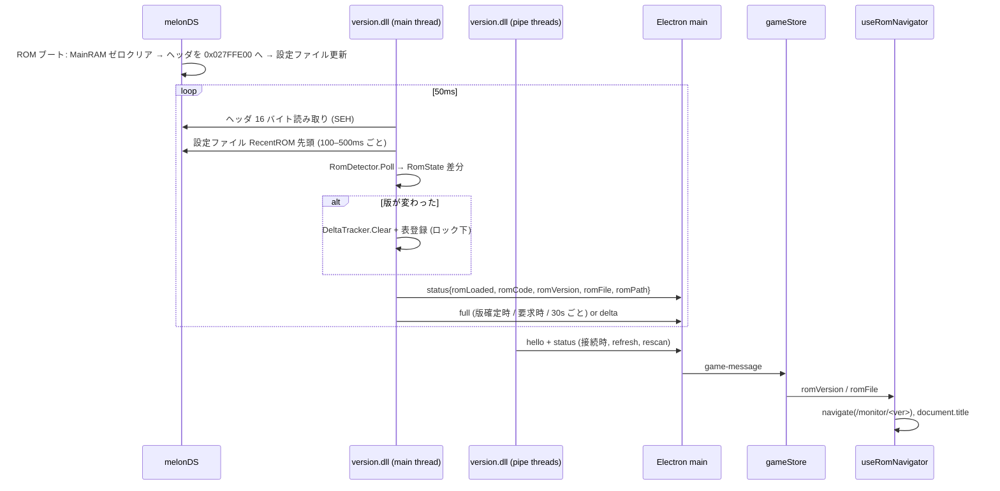

# Design Document

## Overview

**Purpose**: version.dll が melonDS にロードされた ROM を自動判定し、流星のロックマン3 の版 (BA / RJ) と
ROM ファイル名をデスクトップアプリへ通知する。アプリはユーザー操作なしでモニター画面へ進み、
ROM 切り替えにも追従し、キャプションに ROM 名と版を表示する。

**Users**: 流星のロックマン3 を melonDS (1.x または 0.9.5) で動かし、複数の .nds コピーを
セーブスロットとして使い分けるプレイヤー。

**Impact**: 手動バージョン選択 (`setVersion` コマンド、待機画面の BA/RJ ボタン) を廃止する。
DLL のメインループが MainRAM 検出・ROM 判定・アドレス表切替を一手に担い、
フロントはアプリ全体で 1 か所が gameAPI を購読して画面遷移とキャプションを制御する。

### Goals
- ROM ロード後 1 秒以内に版を判定してモニター画面へ遷移する
- melonDS を開いたままの ROM 切り替え (別版 / 同版の別ファイル / 非対応 ROM) に追従する
- キャプションに `<ファイル名> [RJ]` 形式で ROM を表示する
- melonDS 1.x / 0.9.5 の両方で同じ DLL が動く

### Non-Goals
- melonDS 終了後のパイプ自動再接続
- Web 版の変更
- アーカイブ内 ROM の内容照合

## Architecture

### Existing Architecture Analysis
- DLL: `MainThreadFunc` が 50ms ループで DeltaTracker を更新。`setVersion` 受信まで待機し、
  パイプ側スレッド (ReadThread / ServerThread) からも無ロックで DeltaTracker を触っていた。
- Electron main は Named Pipe のメッセージを `game-message` でレンダラへ素通しする。
- UI: `DesktopHome` が自前で購読し、版ボタンで `/monitor/:version` へ遷移。`MonitorPage` が
  マウント時に `subscribeGameAPI(version)` → `setVersion` を送り、アンマウントで store を `reset()`。
- `AppLayout` は web の `/health` ツリーでも使われる。

### Architecture Pattern & Boundary Map



**Architecture Integration**:
- Selected pattern: DLL 側は「メインスレッド単一ライター + ミューテックス + atomic 要求フラグ」。
  UI 側は「レイアウト直下の単一購読フック (useRomNavigator)」。
- Domain boundaries: ROM 判定ロジックは `rom_detect.h` (純粋関数 + RomDetector) に閉じ、
  DLL グローバルには触らない。UI の遷移判断は `useRomNavigator` のみ。
- Existing patterns preserved: Named Pipe JSON プロトコル、Zustand store、react-router ルート構造、i18n キー構成。
- Steering compliance: TypeScript strict、`any` 不使用、型は `types/` の `Version` を再利用。

### Technology Stack

| Layer | Choice / Version | Role in Feature | Notes |
|-------|------------------|-----------------|-------|
| Native | C++17 / VS2022 / Win32 | ROM 判定・設定ファイル読取・アドレス表切替 | MinHook は使わない |
| Messaging | Named Pipe + LF 区切り JSON | `status` 拡張 | `specs/pipe-protocol-spec.md` |
| Desktop | Electron 34 | メッセージ素通し | `document.title` がキャプションに反映 |
| UI | React 19 + Zustand + react-router v7 + MUI | 自動遷移・キャプション・待機画面 | |

## Components and Interfaces

| Component | Layer | Intent | Req Coverage | Contracts |
|-----------|-------|--------|--------------|-----------|
| `rom_detect.h` (RomState, RomDetector, 設定ファイル解析) | DLL | ROM 状態の算出 | 1.1, 1.2, 2.1, 2.3, 2.4, 3.1–3.5, 6.1 | RomState |
| `dllmain.cpp` MainThreadFunc | DLL | 自動検出・表切替・送信 | 1.3, 2.2, 2.5, 6.2, 6.3 | status JSON |
| `dllmain.cpp` HandleCommand / BuildStatusJson | DLL | パイプ側応答 | 1.4, 6.3, 6.4 | status JSON |
| `DeltaTracker::Clear` | DLL | 表の破棄 | 1.3 | |
| `gameStore` | UI | ROM 状態の保持・値のリセット | 2.5, 4.6 | StatusMessage |
| `useRomNavigator` / `DesktopLayout` | UI | 購読・遷移・キャプション | 4.2–4.4, 4.6, 5.1–5.3 | |
| `DesktopHome` | UI | 2 段の待機画面 | 4.1, 4.5 | |
| `MonitorPage` / `GameMonitor` | UI | 購読を持たない表示 | 4.4, 4.6 | |

### DLL

#### RomDetector (`rom_detect.h`)

| Field | Detail |
|-------|--------|
| Intent | ヘッダ 16 バイトと設定ファイルから RomState を算出し、前回との差分を返す |
| Requirements | 1.1, 1.2, 2.1, 2.3, 2.4, 3.1–3.5, 6.1 |

**Responsibilities & Constraints**
- 入力はヘッダ 16 バイト (読めなければ nullptr)。MainRAM アクセスは呼び出し側 (`ReadCartHeader`) が SEH 付きで行う。
- 全ゼロは 6 ポーリング (300ms) 続いた時だけ「未ロード」。melonDS の Reset でのゼロ瞬間を無視する。
- 設定ファイルは「ヘッダ変化直後は即、名前未確定の間 100ms、確定後 500ms」で読む。
  読めない / 書き込み途中 (サイズ 0、閉じ引用符なし) は前回値を維持。
- `verifiedPath` はファイル先頭 16 バイトがヘッダと一致した時だけ設定。アーカイブ形式 (`|`) は照合せず採用。
- 設定ファイルの場所は毎回解決 (`<exe>\[portable\]melonDS.toml` → `melonDS.ini`)。

```cpp
struct RomState { bool loaded; char code[5]; char title[13]; char version[3]; std::string file, path; };
struct RomDetector { bool Poll(const uint8_t* hdr16, const RomState& prev, RomState& out); };
```

#### MainThreadFunc / スレッド規約 (`dllmain.cpp`)

| Field | Detail |
|-------|--------|
| Intent | 50ms ループで (a) MainRAM 検出 (b) ROM 監視と表切替 (c) 値送信 |
| Requirements | 1.3, 2.2, 2.5, 6.2, 6.3 |

| スレッド | 許可される操作 |
|---|---|
| メインスレッド | ヒープスキャン、`RomDetector::Poll`、`DeltaTracker` の Clear/Register/Update/Build、`g_rom`/`g_mainRAM` の書き込み (すべて `g_stateMutex` 下)。`Send` はロック外 |
| ReadThread (`HandleCommand`) | `ping`; `refresh` → status 送信 + `g_fullRequested`; `rescan` → `g_rescanRequested` + status 送信; `write` → ロック下で `FindByName` + `WriteMemory` |
| ServerThread (`OnConnect`) | hello (ロック下で生成) + status 送信 + `g_fullRequested` |

- `g_fullRequested` は版が不明な間は毎 tick 捨てる (版が決まれば改めて立つ)。
- MainRAM のヒープスキャンはクライアント接続中のみ 500ms 間隔 (未接続時の CPU を使わない)。

#### status JSON 契約

```json
{"type":"status","connected":true,"gameActive":true,"mainram":"0x...",
 "romLoaded":true,"romCode":"CRRJ","romVersion":"RJ",
 "romFile":"ビググレ種.nds","romPath":"C:\\...\\save\\ビググレ種.nds"}
```

| フィールド | 型 | 意味 |
|---|---|---|
| `romLoaded` | boolean | ヘッダミラーが全ゼロでない |
| `romCode` | string | ゲームコード 4 文字、未ロード時 "" |
| `romVersion` | `"RJ"` / `"BA"` / `""` | 判定した版 |
| `romFile` | string | ファイル名 (確認済みの時だけ)、それ以外 "" |
| `romPath` | string | フルパス (確認済みの時だけ) |

送信タイミング: 接続時 / `refresh` / `rescan` / MainRAM 検出時 / ROM 状態変化時。

### UI

#### gameStore

| Field | Detail |
|-------|--------|
| Intent | ROM 状態を保持し、版・ファイルが変わった時に値系をリセットする |
| Requirements | 2.5, 4.6 |

- `GameState` に `romLoaded / romCode / romVersion: Version | '' / romFile / romPath` を追加。
- `status` 受信時、`romVersion` 変化または `romPath` が非空→別の非空に変化した時は値系 (`values`, `lastDelta*`, ロック用 `_` フラグ) を初期化。
- `setPipeConnected(false)` で rom 系と値系も初期化。
- `subscribeGameAPI()` は引数なし。`setVersion` は送らない。

#### useRomNavigator / DesktopLayout

| Field | Detail |
|-------|--------|
| Intent | アプリ生存中の購読、`romVersion` に基づく遷移、`document.title` 更新 |
| Requirements | 4.2, 4.3, 4.4, 4.6, 5.1–5.3 |

- `DesktopLayout` = `useRomNavigator()` + `<AppLayout />`。`routes.tsx` の desktop ルートだけで使う。
- 遷移規則: `romVersion` が BA/RJ で、path が `/` または `/monitor/<別版>` なら `/monitor/<romVersion>` へ `replace`。
  `/` からの遷移時のみ 800x1030 にリサイズ。`romVersion` が '' になっても遷移しない。
- キャプション: `APP_TITLE - <name> [RJ]` / `APP_TITLE - <name>` / `APP_TITLE - [RJ]` / `APP_TITLE`
  (`name` = `romFile` から拡張子を除いたもの)。

## Requirements Traceability

| Requirement | Summary | Components |
|---|---|---|
| 1.1–1.2 | ゲームコードで版判定 | RomDetector, VersionFromCode |
| 1.3 | 表の入れ替えと full | ApplyVersionLocked, MainThreadFunc(b)(c) |
| 1.4, 6.4 | setVersion 廃止 | HandleCommand |
| 2.1–2.5 | 切り替え検知 | RomDetector, MainThreadFunc(b) |
| 3.1–3.5 | ファイル名取得 | ResolveMelonConfigPath, ParseRecentToml/Ini, FileHeaderMatches |
| 4.1, 4.5 | 待機画面 | DesktopHome |
| 4.2–4.4, 4.6 | 自動遷移・購読 | useRomNavigator, DesktopLayout, gameStore |
| 5.1–5.3 | キャプション | useRomNavigator.formatCaption |
| 6.1 | toml / ini 両対応 | ReadRecentRomEntry |
| 6.2 | MainRAM 自動検出 | MainThreadFunc(a) |
| 6.3 | スレッド規約 | g_stateMutex, 要求フラグ |

## Testing Strategy

- ビルド: MSBuild (Release x64)、`yarn build:web` (型検査)、`yarn build:desktop`。
- 実機 (melonDS 1.1 / 0.9.5): ROM 無し起動 → 待機、RJ ロード → `/monitor/RJ` + キャプション、
  Ctrl+O で BA へ切替 → `/monitor/BA` + 値の入れ替え、同版の別ファイル → キャプションのみ更新、
  Reset → 待機画面へ戻らない、アプリ再起動 → 接続直後に復帰。
- 旧クライアントの `setVersion` → `UNKNOWN_CMD` で継続。
